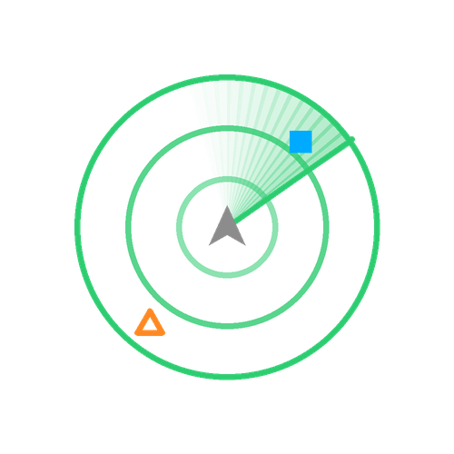

# EDMC-ExplorerLite

An unobtrusive, lightweight exploration and exobiology assistant for [EDMC](https://github.com/EDCD/EDMarketConnector).

At every stage of exploring a system ExplorerLite tells you whether it's worth your time and what's worth doing next, in a clean, compact panel that gets out of the way when there's nothing to report. It's designed to be lightweight and self-contained with overlay support for single-screen/heads-up operation.

## Key Features

- Clean, simple, theme-aware UI shows the information you need and nothing you don't.
- Unobtrusive when you aren't exploring (👁/🙈 toggle minimizes the display and hides overlays).
- In-game overlays provide a summary and a sample-tracking radar.
- Honk heuristic flags whether a system is worth a full FSS pass, based on star type and body/signal counts.
- Flags bodies whose cartography (scan/mapping) value or exobiology potential meets your configured credit thresholds, including first-discovery/first-mapped bonuses.
- FSS prediction ranks likely biology from a body's atmosphere, temperature, gravity, and volcanism as soon as it's scanned
- FSS predictions for surface mining selected commodities and materials
- Live per-species sampling progress once you're on the ground, including the first-logged bonus.
- Waypoints track other species tagged with the composition scanner.
- History browser with running sold/pending totals for both cartography and exobiology.
- Multi-commander support.

## Installation

Create a directory in your EDMC `plugins` folder called `EDMC-ExplorerLite`, download the latest release .zip file and extract it into that directory, then restart EDMC.

## Process and Recommendations

The system line shows the system name, body count if known, and recommended next action, e.g. `Deltius — 7 bodies — **DSS**`.

The order of recommendations is `Honk` → `FSS` → `DSS` / `Sample` / `DSS + Sample` → `Done`.

`Honk` (Discovery Scan) stays until you've run a discovery scan.

`FSS` (Full Spectrum Scan) stays until you've finished scanning the system bodies.

`DSS` (Detailed Surface Scan) means a scanned body is worth mapping, either for its cargographic value or its biological value.

`Sample` (Genetic Sampling) means a mapped body has biology work sampling.

`DSS + Sample` means both are true somewhere in the system.

`Done` there's nothing else recommended to do.

### Discovery Scan (aka Honk)

You should perform this on arrival at every system. It determines how many bodies there are in the system. If they're all stars ExplorerLite will then show `Done`. If there are bodies that may be worthwhile it will say `FSS`

## FSS

As bodies are scanned, any whose estimated cartography value clears your mapping threshold are listed with their type (`T HMC`, `WW`, `ELW`, `AW`, `GG`, etc. — `T` prefix for terraformable), distance, gravity, and approximate value.

## DSS

Bodies whose value exceeds a configurable threshold are recommended for DSS as are planets whose likely biologicals exceed a configurable threshold.

## Exobiology

When the FSS reports biological signals on a body, ExplorerLite indicates likely genera based on the body's atmosphere, temperature, gravity, volcanism, and nearby star type. Estimated genera are shown with a `?` prefix and a value range until confirmed. The DSS narrows this to the genera actually present and the first genetic sample per genus locks in the exact species (if not already determined) and variant.

### Sampling

Per-species genetic sampling progress (`N/M scanned`) is shown live while you're on the body, along with the minimum distance required between samples for that genus. Values shown always include the first-discovery/first-logged bonus you'd actually be paid — not just the base value that only matters for in-game session-progression math.

### Waypoints

Waypoints solve the problem of the genetic sampler only doing on species at a time. If you find a location for a different species, tag it with the composition scanner and it gets added to the [radar overlay](#sample-radar) as a waypoint to return to later. As species are sampled their waypoints are automatically removed from the radar.

## Surface Mining

Surface mining commodity and material predictions can be shown once a body has been FSS scanned.

Predictions are optional and only display if you have a Mk II Large Planetary Vehicle Hangar installed and have turned on `Show mining rows` in preferences. You can restrict which commodities and materials are displayed by entering a list of commodities and materials as well as probability and concentration thresholds (probability for commodities, concentraion for materials).

## Overlays

Requires the [modern overlay](https://github.com/SweetJonnySauce/EDMCModernOverlay), the legacy `EDMCOverlay`/`edmcoverlay2` plugins aren't supported. Without it, ExplorerLite still works fully — the overlay is a heads-up convenience, not a requirement. The panel's 👁/🙈 header toggle hides both overlay elements too, alongside the panel's own content. Both also hide automatically whenever they'd just be in the way — docked, on-foot inside a station, with any ship/on-foot panel (galaxy map, system map, station services, etc.) open, etc..

Two independently configurable overlays:

### System summary

Mirrors the panel's own header and flagged-body list (same columns: distance, gravity, type, value), capped to a handful of lines (with a "+N more" overflow) so it stays glanceable. The body you're currently walking, driving, or flying on/over gets its own indented species-progress detail underneath. Text colour is configurable. Background, border and position are configurable via Modern Overlay's overlay controller.

### Sample radar

Offers two views. Both are centered on you with distance rings; a square for each logged sample (filled = in range, hollow = out of range); and a hollow triangle for each tagged waypoint. Samples and waypoints are colored by species variant. Both radar views rotate with your heading and their size, border, background, and position are all configurable.

The difference is that the first view is commander-focused showing a highlighted ring the size of the current genus' minimum sample distance centered on your current location. If there are any sample squares within this ring you're too close to take a new sample.

The alternate view is sample-focused showing a ring around each sample and waypoint whose radius is the genus' minimum sample distance. If you are within the ring of an existing sample or waypoint you are too close for another sample of that genus. Because the radar range is slightly non-linear circles may shrink slightly as they move further away.

Note, while the commander-focused view looks better with a circle-capable overlay, such as [ModernOverlay v0.9.2](https://github.com/SweetJonnySauce/EDMCModernOverlay/releases) or later, it can work without it. The sample-focused view however requires a circle-capable overlay.

**Commander-focused (without and with ModernOverlay >= 0.9.2)**

**Sample-focused (requires ModernOverlay >= 0.9.2)**

## Panel header

The ExplorerLite display can be collapsed minimizing its space use and hiding overlays keeping it out of the way when you aren't exploring. In addition to manually showing/hiding the panel it is adaptive. If you switch to a ship without a DSS scanner it hides itself. If you switch to one with a scanner it shows itself.

When hidden just the top row of the panel is visible — the plugin name and icon on the left, your estimated unredeemed cartography and exobiology credits in the middle, and two icon buttons on the right (all four have tooltips):

- 🕓 button opens the History browser (below).
- 🙈/👁 buttons show or hide everything below the header as well as the overlays. Data collection continues but this declutters the EDMC window. Your choice is remembered across restarts.

## History

Click 🕓 on the panel to open a System → Body → Species browser (per Cmdr), showing status, date, and both estimated and actual value for cartography (`Cart. Est.`/`Cart. Actual`) and exobiology (`Exo. Base`/`Exo. Full`). A running totals line at the top shows sold vs. still-pending credits for both categories, alongside an "Unsold only" checkbox (on by default) and a time-range dropdown (All time/Last day/Last week/Last month) so a long career's history stays manageable — both choices are remembered across sessions, as is window size/position. The underlying query is also capped to the 1,000 most recently visited systems.

Sold values come from the ED journal so are accurate and include bonuses and crew wages. Unsold values are estimates based on available data and so may be slightly inaccurate.

## Settings

The following settings are configurable from the EDMC preferences panel:

- **Thresholds** — minimum cartography (scan/mapping) value, minimum exobiology species value, panel lines before scrolling
- **Mining Predictions** — enable/disable mining predictions, commodity list, commodity probability threshold, material list, material concentration threshold.
- **Overlays** — system summary on/off, overlay summary text colour, radar on/off, radar type, radar size, sweep on/off. All are greyed out if no overlay backend is installed.
- **Debug** — developer/debug logging
- **Data** — a **Clear unsold data** button for when your ship was destroyed while EDMC wasn't running to see it happen (normally, dying marks all held-but-unsold cartography and exobiology data as lost automatically). Asks for confirmation first, since it can't be undone.

## Persistence

All data and progress is stored locally in a per-install database segmented per commander. The only network call ExplorerLite makes is its own update check against this repo's GitHub releases.

## Requirements

- A recent version of EDMC (needs `plugin_app`/`dashboard_entry` support).
- Optional: [EDMCModernOverlay](https://github.com/SweetJonnySauce/EDMCModernOverlay) for the radar and system-summary overlays.

## AI Disclosure

I'm a long time professional software developer and, like virtually all professional developers, I use AI on a daily basis for anything from commit comments to writing code.

This plugin was conceived, specified, and designed by a human. The code was substantially written by AI with human oversight. This falls into Category 3: Collaborator / Task Agent.

## Acknowledgements

- Cartography value constants cross-checked against two independent community sources, including the Frontier forums' "Exploration value formulae" thread.
- Exobiology species value/distance data sourced from the Elite Dangerous Fandom wiki's "Exobiology Sample Values and Details" page, cross-checked against [njthomson/SrvSurvey](https://github.com/njthomson/SrvSurvey)'s organic-scanning reference.
- Genus spawn-condition data independently transcribed from public sources, cross-checked against [Silarn/EDMC-BioScan](https://github.com/Silarn/EDMC-BioScan) (GPLv2) and ed-dsn.net's community temperature-band data.
- Surface mining data independently transcribed from the community prospecting survey published by EDIntel and distributed by [Fumlop/EDRhinoSpotter](https://github.com/Fumlop/EDRhinoSpotter).
- Codex-tag overlay colors cross-checked against EDMC-BioScan's own variant color names.

## Suggestions

Please let me know if you have any suggestions or find any bugs by submitting an [issue](https://github.com/dwomble/EDMC-ExplorerLite/issues), and if you like ExplorerLite I don't need a coffee, I live in Seattle so I'm plenty caffeinated already, but please give it a ⭐.

Fly dangerous! o7
